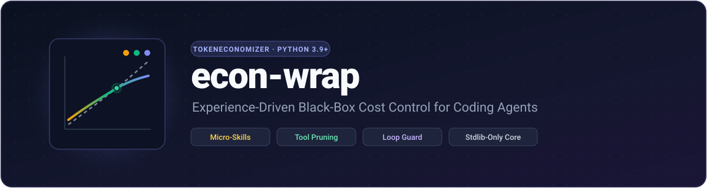
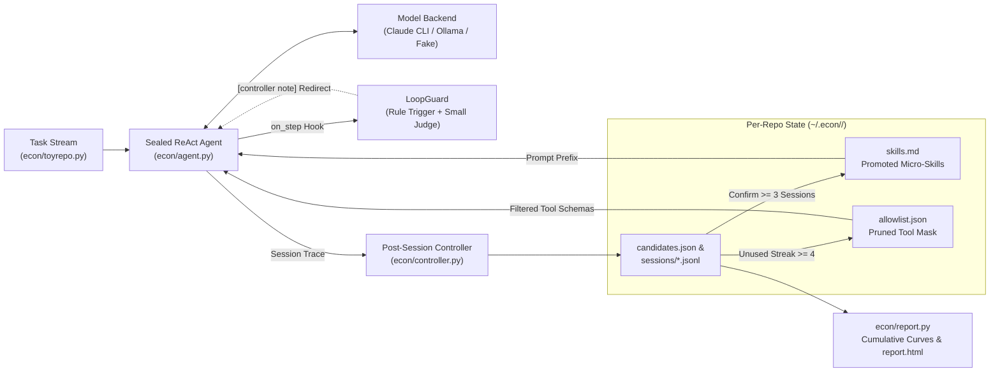

<div align="center">



[](econ/__init__.py)
[](econ/controller.py)
[](https://arxiv.org/abs/2610.22732)
[](econ/backend.py)
[](https://github.com/aayushhzz/econ-wrap)

**A runnable, stdlib-only Python implementation of _TokenEconomizer: Experience-Driven Black-Box Cost Control for Coding Agents_ (Li et al., arXiv 2610.22732).**

[Architecture](#architecture) · [Three Levers](#three-levers) · [Setup](#setup) · [Usage](#usage) · [Demo Results](#demo-results) · [Tests](#tests) · [Project Structure](#project-structure)

</div>

---

## Overview

Coding agents are typically evaluated one task at a time, but real engineering happens over a stream of tasks in the same repository. Without memory across sessions, the agent repeatedly rediscovers test commands, re-bills unused tool schemas on every turn, and burns steps in failure loops.

`econ-wrap` wraps an unmodified ReAct coding agent (`econ/agent.py`) from the outside — touching only the instruction prefix, the tool allowlist, and a live `on_step` hook — to learn per-repository cost-saving policies and measure whether cumulative token cost crosses below the uncontrolled baseline.

See [PAPER_NOTES.md](PAPER_NOTES.md) for the full paper-to-code mapping and simplifications, and [docs/architecture.md](docs/architecture.md) for runtime state schemas and arm isolation.

## Architecture



## Three Levers

1. **Micro-Skills (`skills.md`):** A small model mines one-line repo facts with executable `confirm` regexes from finished session traces. The controller evaluates regexes deterministically and promotes a fact only after `MIN_CONFIRM = 3` distinct confirming sessions (retiring on contradiction with `lambda = 5`).
2. **Tool Pruning (`allowlist.json`):** Core tools (`tools.PROTECTED`) are always kept. Non-protected tools unused for `N = 4` consecutive sessions (including 5 deliberately irrelevant tools in the toy catalog) are masked from the agent's schema. Reversible anytime via `./bin/econ restore-tools`.
3. **Failure-Loop Guard (`LoopGuard`):** A model-free rule trigger monitors repeated failure signatures and edit churn; only when it fires does a small judge evaluate the trace and optionally inject a `[controller note]` redirect without aborting the session.

## Setup

**Requirements:** macOS or Linux, Python 3.9+, and the Claude Code CLI logged in with a personal subscription (`claude auth status` shows `authMethod: claude.ai`). No API key is needed (`ANTHROPIC_API_KEY` is never read or set).

```sh
python3 -m venv .venv && .venv/bin/pip install pytest
```

> The controller itself imports **nothing outside the Python standard library** (enforced by tests). `pytest` is installed solely for running the test suite and the toy repository's task checks.

## Usage

```sh
./bin/econ run --tasks 1-3                 # controlled agent on tasks 1-3; state in ~/.econ/<repo-hash>/
./bin/econ run --tasks 4 --arm baseline    # same agent, no controller
./bin/econ restore-tools                   # undo tool pruning for the repo
./bin/econ report --tasks 1-6              # baseline, controlled & 3 ablations -> runs/report/report.html
./bin/econ report --render-only            # re-render HTML report from saved results
```

### Environment Variables

| Variable | Default | Purpose |
|---|---|---|
| `ECON_MODEL` | CLI default | Agent model (e.g. `haiku`, `sonnet`, or full model ID) |
| `ECON_SMALL_MODEL` | `haiku` | Miner and loop-guard judge model |
| `ECON_HOME` | `~/.econ` | Root directory for per-repo state |
| `ECON_BACKEND` | `claude` | Set to `ollama` for local execution (`qwen3:8b` agent, `qwen3:4b-instruct` judge) |

Each Claude CLI call runs with `--tools ""`, `--setting-sources ""`, `--settings '{"disableAllHooks": true}'`, `--strict-mcp-config`, and `--no-session-persistence`, isolating the agent strictly to `econ/tools.py` inside the throwaway toy repo.

## Demo Results

From a 5-arm × 6-task run on 2026-11-20 (`ECON_MODEL=haiku ./bin/econ report --tasks 1-6 --max-steps 12`; full console log in `runs/report/demo_output.txt`):

| Arm | Passed | Total Tokens | Tokens vs Baseline | Notional Cache-Aware $ | Break-Even Task |
|---|---:|---:|---:|---:|---:|
| `baseline` | 5/6 | 286,294 | — | $0.0390 | — |
| `controlled` | 6/6 | 277,711 *(29,045 controller)* | **-3.0%** | $0.0429 | **6** |
| `skills-only` | 5/6 | 291,873 | +1.9% | $0.0418 | not reached |
| `prune-only` | 6/6 | 255,137 | **-10.9%** | $0.0379 | **2** |
| `guard-only` | 4/6 | 296,783 | +3.7% | $0.0410 | not reached |

Key observations:
- **Micro-skills promoted:** `PYTHONPATH=src python -m pytest` (after session 3), `python scripts/fmt.py` (after session 5), and `python scripts/gen_fixtures.py` (after session 6).
- **Tool pruning** was the largest single lever, pruning the 5 irrelevant tools (`http_get`, `sql_query`, `image_resize`, `send_email`, `translate_text`) after session 4.
- **Break-even:** Controlled cost started higher (+10% to +17% on tasks 1–3) due to controller overhead and crossed below baseline at **task 6** on total tokens. In cache-aware notional dollars, only `prune-only` beat baseline at `n = 6` because prompt caching discounts repeated schemas while controller calls are uncached.
- **Loop guard:** Triggered live once on Ollama (`tasks 13` unsatisfiable probe with `qwen3:8b` / `qwen3:4b-instruct`), injecting a redirect at step 6; no live redirect fired on Claude across the 6-task run.

### Honest Caveats
- Single seed, 6 tasks, and a Haiku agent on a toy repository with 3 planted quirks (`PYTHONPATH=src`, `scripts/gen_fixtures.py`, `make fmt`) — results are illustrative, not a reproduction of the paper's 277-task SWE-Bench benchmark.
- **Personal use only:** Driving the Claude Code CLI via personal `claude.ai` subscription login is for local personal use; deploying for others requires API-key authentication under Anthropic's terms.

## Tests

Run the offline test suite (uses the scripted fake backend — no Claude or Ollama calls):

```sh
.venv/bin/python -m pytest -q tests
```

Covers stdlib-only imports, 3-session micro-skill promotion & contradiction retirement, tool pruning & `restore-tools`, live `LoopGuard` redirect injection, break-even calculations, and toy-repo seeding.

## Project Structure

| Path | Description |
|---|---|
| [econ/agent.py](econ/agent.py) | Sealed black-box ReAct agent configured only via `settings.json` and `on_step` |
| [econ/controller.py](econ/controller.py) | Micro-skills miner/verifier, tool pruner, `LoopGuard`, per-repo `State`, session runner |
| [econ/tools.py](econ/tools.py) | 12 tools (7 repo tools + 5 irrelevant distractor tools) |
| [econ/toyrepo.py](econ/toyrepo.py) | Seeded toy repo with 3 quirks + 12 tasks (plus task 13 loop probe) |
| [econ/backend.py](econ/backend.py) | Unified model interface: `claude` CLI (default), `ollama`, and `fake` |
| [econ/report.py](econ/report.py) | Multi-arm runner, cumulative curves, break-even computation, HTML report renderer |
| [econ/cli.py](econ/cli.py) | CLI entry point (`run`, `report`, `restore-tools`) wrapped by [bin/econ](bin/econ) |
| [tests/test_controller.py](tests/test_controller.py) | Offline unit and integration tests |
| [PAPER_NOTES.md](PAPER_NOTES.md) | Paper mechanism summary, concept-to-code table, and simplifications |
| [docs/architecture.md](docs/architecture.md) | Runtime state files and evaluation arm isolation |

---

<div align="center">

Built by [@aayushhzz](https://github.com/aayushhzz) · [Report an Issue](https://github.com/aayushhzz/econ-wrap/issues)

</div>
